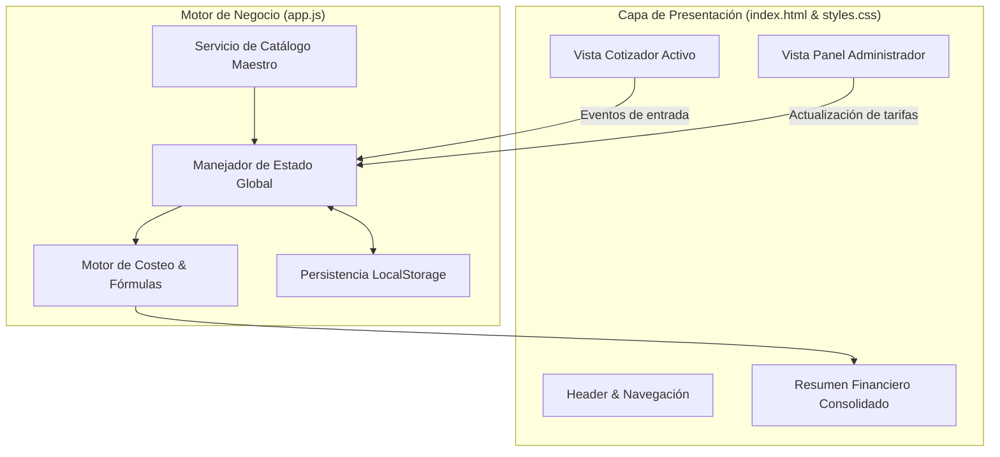

# 💼 DevCost — Sistema Inteligente de Cotización & Costeo de Software

<div align="center">

[](https://sergioandresaparicio.github.io/costeo/)
[](https://developer.mozilla.org/en-US/docs/Web/JavaScript)
[](https://developer.mozilla.org/en-US/docs/Web/CSS)
[](https://en.wikipedia.org/wiki/Cost_estimate)
[](LICENSE)

**Plataforma interactiva para la estimación ágil, estructuración de presupuestos y cotización financiera de proyectos de software basados en el mercado de desarrollo de Colombia e infraestructura cloud.**

[🌐 Probar Cotizador en Vivo](https://sergioandresaparicio.github.io/costeo/) • [📦 Repositorio](https://github.com/Sergioandresaparicio/costeo) • [🐛 Reportar Bug](https://github.com/Sergioandresaparicio/costeo/issues)

</div>

---

## 📖 Descripción del Proyecto

**DevCost** es una herramienta de ingeniería económica diseñada para agencias digitales, consultores de software y desarrolladores independientes que necesitan calcular con precisión científica y viabilidad financiera el presupuesto de proyectos digitales.

El sistema elimina las cotizaciones intuitivas o desfasadas mediante un motor dinámico de cálculo en **JavaScript Vanilla** que pondera:
1. **Horas hombre de ingeniería:** Desglose modular por pantallas, endpoints, lógica de negocio y pruebas.
2. **Costos fijos y variables de infraestructura:** Integración de planes de VPS (Hostinger, AWS, DigitalOcean), dominios, certificados SSL y pasarelas de pago.
3. **Márgenes de rentabilidad e imprevistos:** Coeficientes de riesgo y utilidad empresarial calculados en tiempo real.

---

## ✨ Características Principales

* 🧮 **Motor de Cotización Paramétrico:** Cálculo instantáneo del costo total, precio de venta sugerido y margen operativo según la complejidad (Baja, Media, Alta).
* ⚙️ **Panel de Administración en Vivo:** Permite calibrar en tiempo real las tarifas por hora de perfiles Junior, Mid y Senior, así como los costos de servidores.
* 🔄 **Sincronización de Catálogo Maestro:** Motor de persistencia en `localStorage` con capacidad de restablecer o actualizar los catálogos base de servicios.
* 📑 **Resumen Ejecutivo y Exportación:** Vista consolidada lista para exportar a propuesta comercial o imprimir para el cliente.
* 🚀 **Despliegue Continuo:** Alojado y accesible públicamente a través de **GitHub Pages**.

---

## 🏗️ Arquitectura del Cliente Web



---

## 📂 Estructura del Directorio

```text
costeo/
├── index.html                  # Interfaz principal, cotizador activo y vistas modales
├── styles.css                  # Sistema de diseño, temas, tipografía Inter y layout responsive
├── app.js                      # Motor analítico de cálculo, eventos DOM y gestión de catálogos
├── README.md                   # Documentación técnica completa
├── LICENSE                     # Licencia de código abierto MIT
├── .gitignore                  # Reglas de exclusión de Git
└── scratch/                    # Pruebas unitarias y scripts de validación del motor
    └── test-market-engine.js   # Verificación lógica de tarifas de mercado
```

---

## 🚀 Instalación y Despliegue Local

### Demo en Línea
Puedes acceder directamente a la versión de producción alojada en **GitHub Pages**:
👉 **[https://sergioandresaparicio.github.io/costeo/](https://sergioandresaparicio.github.io/costeo/)**

### Ejecución Local
```bash
# 1. Clonar el repositorio
git clone https://github.com/Sergioandresaparicio/costeo.git

# 2. Navegar a la carpeta
cd costeo

# 3. Abrir index.html
# En Windows (PowerShell):
Start-Process index.html

# O utilizando Live Server en VS Code:
code .
```

---

## 🔄 Flujo de Trabajo Git & Conventional Commits

* `feat(engine): ✨ incorporar cálculo automatizado de VPS e imprevistos`
* `docs(readme): 📚 documentar arquitectura financiera y despliegue en GitHub Pages`
* `fix(admin): 🐛 corregir sincronización del catálogo maestro en localStorage`
* `style(ui): 🎨 pulir paleta de colores y variables CSS de la interfaz`

Gestionado mediante el modelo **Gitflow** con ramas `main`, `develop` y `gh-pages`, acompañado de versiones semánticas `v1.0.0`.

---

## 📄 Licencia

Este proyecto está bajo la Licencia **MIT** — consulta el archivo [LICENSE](LICENSE) para más información.

---

## 👨‍💻 Autor

**Sergio Andrés Aparicio Galvis**  
* 💼 LinkedIn: [sergio-andrés-aparicio-galvis](https://linkedin.com/in/sergio-andr%c3%a9s-aparicio-galvis-62b6b8213)  
* 🐙 GitHub: [@Sergioandresaparicio](https://github.com/Sergioandresaparicio)  
* 📧 Correo: [sergioapariciogalvis@gmail.com](mailto:sergioapariciogalvis@gmail.com)
